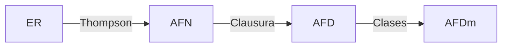
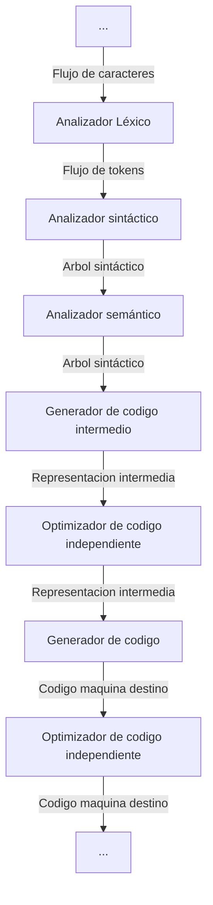

## Clase 10 - AFD$\implies$AFDm

#### Complemento de un AFD
Todo estado final del AFD será NO final del AFD complemento y viceversa. El AFD original debe estar completo, 
#### Intersección de AFDs
Una intersección entre dos AFDs es también un AFD, el cual reconoce solo las palabras que **ambos** AFDs originales reconocerían.
- Los estados del nuevo AFD son pares ordenados de estados de los originales.
- Un par solo es final si ambos estados son finales.
- Construcción:
	1. Se arranca desde el par inicial.
	2. Se calculan sus transiciones.
	3. Se agregan los pares nuevos que aparezcan.
	4. Se continua el calculo y agregación hasta que no surjan nuevos pares.
	5. Los estados erróneos (inalcanzables o que no llevan al final) no se agregan.

#### Comportamiento
Dos estados tienen el mismo comportamiento si ambos son finales/no finales **y** si sus filas en la TT son idénticas.
#### AFD mínimo
Es el AFD que reconoce un lenguaje regular con la menor cantidad de estados posible. Sirve para:
- Saber si dos AFDs son equivalentes.
- Probar si dos ERs son equivalentes.
- Implementar la TT con una matriz más chica en memoria.

## Clase 11
### AFDm$\implies$ER
Se resuelve mediante un algoritmo que usa un sistema de ecuaciones. El proceso es el siguiente:
1. Se depura el AFDm, eliminando estados erróneos.
2. Se crean tantas ecuaciones como estados tenga el AFDm depurado. Cada ecuación se compone de una identidad entre la letra que representa el estado que representa la ecuación y la union de términos compuestos por el producto entre el símbolo y el estado al que va.![[Pasted image 20261115195451.png]]
3. Si hay un bucle se hace el siguiente proceso:![[Pasted image 20261115200217.png]]
4. Se resuelve el sistema restante con la única condición de que la inicial sea la última ecuacion en resolverse.
##### Ejemplo
Depurar: se eliminan el 3 (inalcanzable) y el 5 (rechazo).
- Ecuaciones:
$$0 = a2 + b1$$
$$1 = a4 + \varepsilon$$
$$2 = b4$$ $$4 = b4 + \varepsilon$$
- Reducir el 4 ($e=\alpha e+\beta \Rightarrow e=\alpha^{*}\beta$):
$$4 = b^{*}$$
Sustituir en el 2:
$$2 = bb^{*}$$
Sustituir en el 1:
$$1 = ab^{*} + \varepsilon$$
Sustituir en el 0:
$$0 = abb^* + b(ab^* + \varepsilon)$$
Distribuir:
$$0 = abb^* + bab^* + b$$
Resultado:
$$ER = abb^* + bab^* + b$$

### Autómata de Pila
Es un autómata con la capacidad de reconocer LICs (ademas de los LRs), como las expresiones aritméticas y las sentencias.
Esta constituido por:
1. El flujo de entrada, la cadena a analizar, igual que en un AF.
2. Un control finito, formado por estados y transiciones etiquetadas, igual que en un AF.
3. Una pila abstracta, que hace la diferencia. Es una memoria donde solo se accede al tope, con un alfabeto propio distinto del de entrada.

| Símbolo | Significado                                      |
| ------- | ------------------------------------------------ |
| **E**   | Conjunto finito de estados.                      |
| **A**   | Alfabeto de entrada.                             |
| **A'**  | Alfabeto de pila.                                |
| **e0**  | Estado inicial                                   |
| **p0**  | Símbolo inicial de la pila, indica "pila vacía". |
| **F**   | Conjunto de estados finales                      |
## Clase 12 - Compilación (parte 1)
En términos simples, un compilador es un programa que toma un programa en un lenguaje fuente y lo traduce a su equivalente en un lenguaje destino. Además, reporta errores que detecte durante el proceso de traducción en el programa fuente.

#### Etapa análisis
Se divide el programa fuente en componentes e impone una estructura gramatical sobre ellas. Si encuentra un error léxico, sintáctico o semántico lo informa.

**Análisis léxico:**
1. Entran caracteres al **scanner**.
2. Se agrupan los caracteres en lexemas, los cuales pertenecen a los LRs (también conocidos como tokens) del LP. Los lexemas suelen almacenarse en la tabla de símbolos.
3. Se evalúa a que token pertenece cada lexema.
4. Se almacenan los identificadores en la tabla de símbolos.
5. Si hay errores léxicos se diagnostican.
6.  Se envía el token correspondiente por cada lexema.
7. Salen tokens.

El lenguaje C posee múltiples tokens, entre ellos:

| Token                    | Ejemplo                                                                             |
| ------------------------ | ----------------------------------------------------------------------------------- |
| Identificadores          | `digito`, `noDigito`, `identificador digito`, `identificador noDigito`              |
| Constantes               | `real`, `entero`, `enumeracion`, `caracter`                                         |
| Literales de cadena      | no hay ejemplos                                                                     |
| Caracteres de puntuación | `( ) [ ] { } * , : = ; # .`                                                         |
| Palabras reservadas      | `char do double else float for if int long return sizeof struct typedef void while` |
Algunos símbolos de puntuación también pueden ser operadores. El compilador determina su uso a partir del contexto.

**Derivación (repaso):**
Proceso que permite obtener cada una de las palabras de un LF a partir de una GF mediante la aplicación sucesiva de las producciones de la GF.
La derivación puede ser horizontal ($\implies$) o vertical, desde la derecha o la izquierda. Además existe la derivación de árbol, que muestra todas las posibilidades con el axioma como raíz.
El árbol de derivación tiene las siguientes propiedades:
- El axioma es la raiz.
- Cada hoja corresponde a un terminal (o a un no terminal si es parcial).
- Cada nodo interior es un no terminal.
Para cada cadena de un lenguaje generado por una gramatica es posible construir como minimo un arbol de derivacion en el cual cada hoja tenga cada uno de los simbolos de la cadena.

**Análisis sintáctico:**
1. Entran tokens al **parser**.
2. Se agrupan mediante un grupo de rutinas los tokens en un árbol sintáctico.
3. Se verifica que las estructuras de tokens (expresiones) que componen el programa sean correctas, comprobando con la gramática sintáctica del lenguaje.
	- En las expresiones deben estar bien identificados a precedencia (prioridad) y la asociatividad. Mientras más cerca del axioma de la BNF menos prioridad.
4. Si hay errores sintácticos se diagnostican.
5. Sale el árbol sintáctico.

El árbol puede ser una estructura de datos y puede también no serlo, como en el caso del parser ASDR. 

**Análisis semántico:**
La sintaxis de un programa es como está escrito. La semántica es lo que sucede en tiempo de ejecución.
Las rutinas semánticas llevan a cabo dos funciones:
1. Chequeo de semántica estática (verificación de tipos, etc.).
2. Traducción a código objeto para ser usado en una máquina virtual, que revisa errores en ejecución.
En la mayor parte de los manuales de LPs la definición semántica está dada en lenguaje natural.
La tabla de símbolos puede contener identificadores (con nombre, tipo, localización, ámbito), palabras reservadas, constantes literales y numéricas, etc.
Esta se usa para detectar, por ejemplo, para la si una variable ya fue declarada, o si se suman distintos tipos, si se usa bien una clase, si una variable está afuera del alcance de una función o incluso si una variable está declarada dos veces.

## Clase 12 - Compilación (parte 2, micro)
Una definición completa de un LP debe incluir las especificaciones de su sintaxis y de su semántica.
La sintaxis se divide en componentes independiente de contexto (la gran parte del código), y en componentes sensibles al contexto (compatibilidad de tipos, reglas de alcance, etc.).

#### Lenguaje Micro
- Solo tiene ints.
- Identificadores de máximo 32 caracteres. Empiezan con letras y siguen con letras y dígitos.
- Las constantes son secuencias de dígitos.
- Existen dos tipos de sentencias:
	- ID := Expresión;
	- leer(IDs); escribir(IDs);
- TOKENS:
	- `palabraReservada`
	- `identificador`
	- `constante`
	- `operador`
	- `asignacion`
	- `caracterPuntuacion`

El scanner de Micro está basado en un AFD que reconoce los LRs que forman los tokens de Micro. Para las palabras reservadas existen dos opciones:
- S1: Detectar en el camino si está recorriendo una palabra reservada y si llega a ese estado final entonces es un identificador.
- S2: Marcar en la tabla de simbolos las palabras reservadas como "reservadas" desde el principio y que sean detectadas en el recorrido.
Además, para el parser es necesario recibir token llamado fdt (fin de texto) que determina cuando se termina una entrada.
Si un compilador llega a un caracter ilegal se puede recuperar descartando el caracter invalido, imprimiendo un mensaje de error, dandole un codigo de error al parser y continuando con el siguiente caracter. La compilacion final sera, obvio, erronea.
#### Centinelas
Un centinela es un carácter "espurio" que indica el final del lexema que se esta reconociendo.
Los LR infinitos necesitan un centinela.
Los LR finitos pueden o no necesitarlo:
- Si los lexemas no comparten prefijos $\implies$ no necesita.
- Si hay prefijos iguales (sufijo de X es prefijo de Y, XY necesita un centinela).
- Las palabras reservadas necesitan centinela, por ejemplo for es prefijo de forense.

#### unget
Cada lexema está compuesto por la mayor cantidad de caracteres antes de que su lectura sea interrumpida. Si hay una palabra de |n|, se lee hasta n+1, luego se hace unget y se vuelve a n.

## Clase 16 - Compilación (parte 3, PAS)
#### ASDR
Un parser puede ser bottom-down (recorre el árbol de análisis sintáctico desde los terminales hasta el axioma) o top-down (viceversa). El ASDR es un parser top-down.
En el ASDR la idea es que cada no terminal tenga su propio procedimiento de análisis sintáctico (PAS) que lo implemente, usando el mismo nombre.
Cuando un no terminal tiene una sola producción es bastante simple, mirás el lado derecho y por cada no terminal llamamos a su PAS y listo y para cada terminal llamas a Match(t) y verifica que el token que entrega el scanner sea el que espera la producción.
Cuando un no terminal tiene mas de una producción, se necesita código extra para elegir cual.
Hay un axioma llamado FDT, fin de texto, usado para indicar el fin de un archivo.

